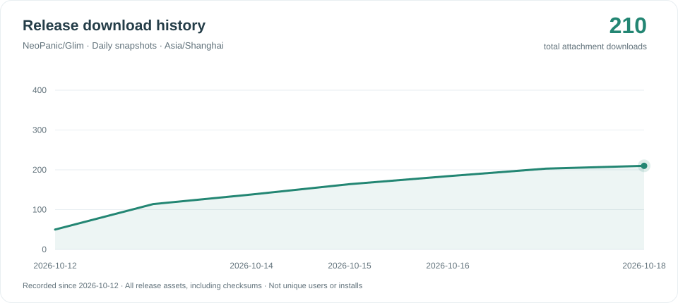

# Glim download history

Daily observations of GitHub's cumulative download counts for all assets of
published releases, including prereleases and checksum files. Drafts are excluded.
These are download counts, not unique users or installations.

Tracking began on 2026-10-12. No earlier history is estimated. One observation is
kept per date in Asia/Shanghai; another run on the same date refreshes that point.
The graph shows the latest 90 observations. Gaps are not backfilled. Totals can
fall if release assets are removed from GitHub.

- [Raw observations](downloads.json)
- [Collector](https://github.com/NeoPanic/Glim/blob/main/scripts/update-download-history.py)
- [Workflow](https://github.com/NeoPanic/Glim/actions/workflows/download-history.yml)

The workflow is scheduled daily at 00:17 Asia/Shanghai and can also be run manually.
GitHub schedules are best-effort and may be delayed. GitHub may disable scheduled
workflows in public repositories after 60 days of inactivity; re-enable the
workflow in Actions if needed. Failed API calls leave the published data unchanged.
