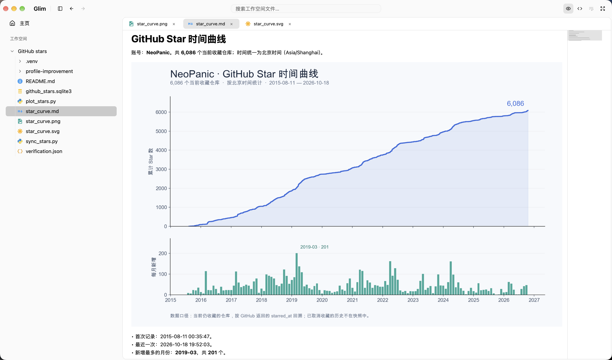

# Glim — File viewer for macOS

Glim is a free, open-source, all-purpose file viewer for Mac. Read Markdown, PDFs, images, JSON, CSV and source code in one workspace.

Free and open source · macOS · Apple Silicon &amp; Intel · <b>English</b> / <a href="README.zh-CN.md">简体中文</a>

<a href="https://glimapp.github.io/">Website / 官网</a> · <a href="https://github.com/glimapp/glim/releases/latest"><strong>Download Glim →</strong></a>

<a href="https://github.com/glimapp/glim/releases/latest">Latest release · Release notes &amp; checksums</a> · <a href="#download">Installation help</a>

Mac downloads are not yet notarized by Apple. You may need to approve the first launch in System Settings. <a href="#macos">See instructions</a>

  
  
  
  

## Documents, data and code in one workspace

The compact interface puts document tabs beside a resizable file sidebar, with workspace search in the title bar. Preview and source controls stay close at hand. The screenshot shows the public [12-factor-agents](https://github.com/humanlayer/12-factor-agents) documentation; its text and illustration belong to that project.

[Download Glim](https://github.com/glimapp/glim/releases/latest) · [Vote for the next format](https://github.com/glimapp/glim/discussions/28) · [Request a file format](https://github.com/glimapp/glim/issues/new?template=feature_request.yml)

| Looking for… | What Glim offers |
| --- | --- |
| A Markdown viewer | Read documents with Mermaid diagrams, tables and LaTeX formulas; switch to source for small edits |
| A JSON viewer | Expand nested objects and arrays, then switch back to the original text |
| A CSV / TSV viewer | Read a table, inspect multiline cell values, or check the source |
| A PDF, image or Office viewer | Keep read-only previews in workspace tabs; Office layout depends on macOS |
| An EPUB reader or SQLite viewer | Read books with bookmarks, or browse local database tables in a read-only snapshot |

## Supported file formats

<a href="docs/file-format-support.md">
  <picture>
    <source media="(prefers-color-scheme: dark)" srcset="assets/readme/formats-dark.svg" />
    <source media="(prefers-color-scheme: light)" srcset="assets/readme/formats.svg" />
    
  </picture>
</a>

*Selected formats: † limited preview. Capabilities and limits are listed below and in the full format guide.*

| Content | What you can do |
| --- | --- |
| Documents | Markdown, static HTML, ordinary UTF-8 text, diagrams and formulas |
| Native documents | Read-only PDF, Word, Excel, PowerPoint, Keynote, Pages, Numbers, and RTF previews |
| Images | PNG, JPEG, WebP, animated GIF, SVG, multipage TIFF, BMP, ICO, ICNS, EXR / HDR |
| Media & tools | Audio/video and folder playlists; fonts and font collections; SQLite tables, schema, and associated WAL files |
| Mind maps | XMind previews with sheet switching, topic folding, zoom and topic details |
| Code & configuration | Rust, Python, JS/TS, Go, C/C++, Java, Swift, Ruby, INI, and more; syntax highlighting and basic text editing |
| Data | JSON / JSONC, CSV / TSV, YAML, TOML, SQL, GeoJSON and notebooks; trees, tables or text previews |
| AI model metadata | safetensors names, shapes, dtypes, and parameter counts, read from the header only |
| First-pass previews | AsciiDoc / Org / RST, subtitles, TSV / NDJSON / JSON5, D2 / Pikchr / Vega, OBJ / STL, archive listings and selected text previews, and more |

**Platform scope:** Glim is maintained for macOS on Apple Silicon and Intel. Both architectures share the file readers and Git workspace described here.

Format details and limits

Markdown includes Mermaid (flowcharts, subgraphs, Journey, Radar, and ZenUML), Graphviz/DOT, PlantUML (including partial Salt and Chen ER support), flowchart.js, WaveDrom, LaTeX, GFM tables, task lists, footnotes, GitHub Alerts, and frontmatter. Failed diagram blocks retain their source.

Large or very long-line text opens in read-only pages. Reader budgets and their effects are listed in the [shared reader policy](docs/reader-limits.md). HTML preview is static and does not execute scripts. Archives support listings and selected text previews, rather than general extraction or full content rendering. Non-UTF-8 text is not currently decoded.

Office layout and media codecs depend on macOS support. XLS/XLSX previews show local tables and stored formula values; use the default application for complete styles, charts, or complex documents.

[Documentation](docs/README.md) · [Full format list and limits](docs/file-format-support.md) · [Roadmap](docs/TODO.md)

## Download

Open the [latest Release page](https://github.com/glimapp/glim/releases/latest) and choose the matching installer under **Assets**. That page contains the current version, release notes and checksums.

| Your device | Installer filename suffix |
| --- | --- |
| Mac · Apple Silicon (M series) | `-macos-arm64.dmg` |
| Mac · Intel | `-macos-x86_64.dmg` |

Not sure which Mac download to choose? Open **Apple menu → About This Mac**. An Apple M-series chip means Apple Silicon; an Intel processor means Intel.

### macOS

Open the DMG and drag Glim into Applications. The app is ad-hoc signed, without Developer ID signing or notarization. If macOS blocks it, try opening it once, then go to **System Settings → Privacy & Security → Open Anyway**. Confirm the download came from this project's releases; there is no need to disable system security. [Apple's instructions](https://support.apple.com/en-us/102445).

[Release notes & SHA-256 checksums](https://github.com/glimapp/glim/releases/latest) · [All releases](https://github.com/glimapp/glim/releases) · [Build from source](docs/releasing.md)

## Get involved

Found a file Glim should open better? [Report a bug](https://github.com/glimapp/glim/issues/new?template=bug_report.yml), [request a format](https://github.com/glimapp/glim/issues/new?template=feature_request.yml), or [start a discussion](https://github.com/glimapp/glim/discussions). English and Chinese are welcome.

[Contributing](CONTRIBUTING.md) · [Build from source](docs/releasing.md) · [Roadmap](docs/TODO.md) · [Security](SECURITY.md) · [MIT License](LICENSE)

## Contributors

Thanks to everyone helping make Glim better.

## Star history

<a href="https://star-history.com/#glimapp/glim&amp;Date">
  <picture>
    <source media="(prefers-color-scheme: dark)" srcset="https://api.star-history.com/svg?repos=glimapp/glim&amp;type=Date&amp;theme=dark" />
    <source media="(prefers-color-scheme: light)" srcset="https://api.star-history.com/svg?repos=glimapp/glim&amp;type=Date" />
    
  </picture>
</a>

## Download history

<a href="https://github.com/glimapp/glim/tree/codex/download-stats">
  <picture>
    <source media="(prefers-color-scheme: dark)" srcset="https://raw.githubusercontent.com/glimapp/glim/refs/heads/codex/download-stats/downloads-dark.svg" />
    <source media="(prefers-color-scheme: light)" srcset="https://raw.githubusercontent.com/glimapp/glim/refs/heads/codex/download-stats/downloads.svg" />
    
  </picture>
</a>

Daily snapshots of cumulative public GitHub release-asset downloads, including installers, update feeds, checksums and release-verification requests. Tracking starts on **2026-10-12**; earlier history is unavailable. These counts are downloads, not unique users or installs.
